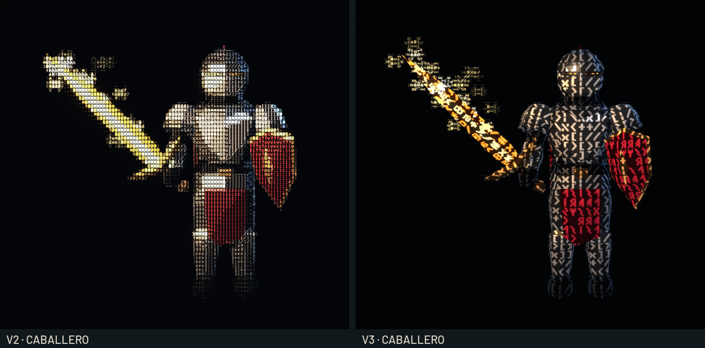

# ASHEN · El Osario de la Vigilia

Demo jugable de fantasía oscura con renderizado ASCII en GPU. En la rama experimental, V3 aplica glifos a la armadura y a los efectos antes de componer la arquitectura y el fondo en pantalla. V2 sigue disponible en ASCII Studio y en el laboratorio.

## Jugar en Windows
Extrae el ZIP completo de la demo y abre `ASHEN.exe`. Desde fuentes, usa Godot 4.7.2 .NET y un SDK .NET 8 o posterior. En PowerShell, `./scripts/setup-portable.ps1` prepara el editor local y `./run.ps1` compila y abre el juego. También puedes indicar el editor con `-Godot` o `GODOT4`.

| Control | Acción |
| --- | --- |
| WASD y ratón | Mover y orientar al caballero |
| Clic izquierdo y Espacio | Atacar y esquivar |
| Q/E y rueda | Girar y acercar la cámara |
| F1 y F2 | Abrir ASCII Studio y comparar con 3D |
| F3, F11 y C | Rendimiento, pantalla completa y recorrido |
| Esc | Pausa, laboratorio, reinicio y salida |

En el laboratorio, 1 abre 3D, 2 el ASCII original, 3 V2 y 4 V3. Espacio alterna el giro y L cambia la iluminación cálida. Q/E y la rueda ajustan el encuadre. Esc vuelve al Osario. También puedes abrir el laboratorio desde fuentes con `./run.ps1 -GameArgs @('--','--lab')`.

[Comparación del Osario](docs/evidence/ascii-v3/osario.jpg) · [Detalle de glifos](docs/evidence/ascii-v3/detalle.png) · [Movimiento](docs/evidence/ascii-v3/movimiento.jpg)

## Validar y continuar
`./scripts/validate.ps1 -Graphics -Capture -Benchmark` ejecuta pruebas y captura evidencia. Para exportar, ejecuta `./scripts/setup-portable.ps1 -ExportTemplates` y `./scripts/export-windows.ps1`. La exportación V3 queda en `build/windows-v3`. Conserva el EXE, el PCK y el directorio de datos .NET juntos.

[Renderizado](docs/RENDERING.md) · [Rendimiento](docs/PERFORMANCE.md) · [Pruebas](docs/TESTING.md) · [Estado](PROJECT_STATE.md)
